# TheNext.Click Internship — Task & Project Management Web Application

This repository documents my introductory internship at **TheNext.Click (TNC)** and the project I worked on: a web application for managing tasks and projects. The application work covered interface design, Flask API development, TinyDB integration, and connecting the front end to the back end.

The internship report is the primary source for the timeline, implementation details, routes, and outcomes below. All **24 unique images** embedded in the report have been extracted into [`assets/report/`](assets/report/) and included in the relevant sections of this README.

## Project overview

The goal was to build a web application that helps users create, assign, organize, and follow tasks within projects. The report describes these main capabilities:

- Authenticate users before they access the application.
- Create, list, update, and delete tasks.
- Associate tasks with projects, categories, clients, and assignees.
- Track status, progress, deadlines, and hours.
- Display project summaries, including task counts and total hours.
- Filter and sort tasks, and provide dashboard-level summaries.

The report frames the work as an iterative full-stack project: gather requirements, plan and design the interface, implement the front end and API, integrate data storage, then test and refine the result.

## Technology and architecture

The documented architecture separates the browser interface, Flask application, and TinyDB persistence layer:

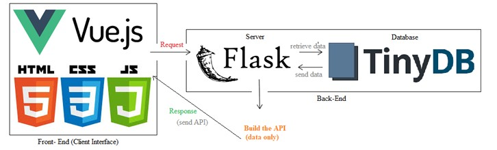

### Stack and tools

| Area | Technologies and tools | Role in the project |
|---|---|---|
| Front end | HTML, CSS, JavaScript, Vue.js | Page structure, styling, interactive application interface |
| Back end | Python, Flask | Server-side logic, sessions, and application/API routes |
| Data storage | TinyDB | Lightweight JSON-based storage for users, tasks, projects, and related data |
| API exploration and testing | Postman | Mock-server exploration and endpoint testing |
| Development and version control | Visual Studio Code, Git | Editing, debugging, and tracking project changes |

The report's methodology describes an early Postman mock-server exercise and a short-lived Express/TinyDB setup before settling on Flask for the server. Vue.js was used as the interface work progressed.

| Git | Visual Studio Code | Postman |
|---|---|---|
| 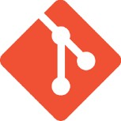 |  |  |

The report's data-model illustration connects users and tasks, shows tasks grouped under projects, and lists task-status categories.

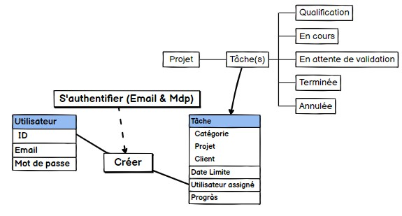

## Internship and development timeline

The report gives the following dated milestones for the project work:

| Date | Work described in the report |
|---|---|
| **August 1, 2024** | Explored a Postman mock server to understand request and response flows. |
| **August 2, 2024** | Ran an initial Express/TinyDB setup, then transitioned the server to Flask. |
| **August 6, 2024** | Began improving the graphical interface with Vue.js. |
| **August 7–12, 2024** | Continued the task-management interface and its navigation and page design. |
| **August 13, 2024** | Refined task editing and deletion and planned a task-classification view. |
| **August 15, 2024** | Focused on the back-end CRUD requirements and front-end/back-end integration. |
| **August 19, 2024** | Connected the web application to the Flask server and TinyDB. |
| **August 20, 2024** | Implemented task CRUD operations to fetch, display, and modify task data. |

The report also describes the broader development process: requirements and use cases, architecture and mock-ups, implementation, then unit/integration checks, user acceptance feedback, debugging, and performance checks.

## Application features

The following screenshots are extracted from the report's application walkthrough. Interface labels are shown as they appear in the screenshots.

### Authentication

The login screen is the application's entry point. The report describes credential validation and redirecting authenticated users to the main application.

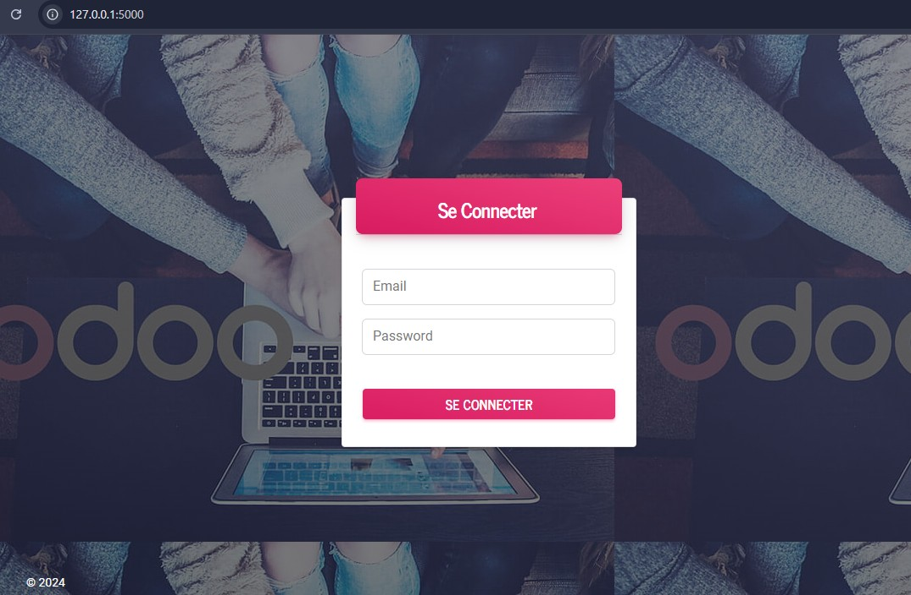

### Task management

The task views cover a task list, task creation, and task editing. The report lists task details such as name, category, project, hours, client, progress, assignee, and status.

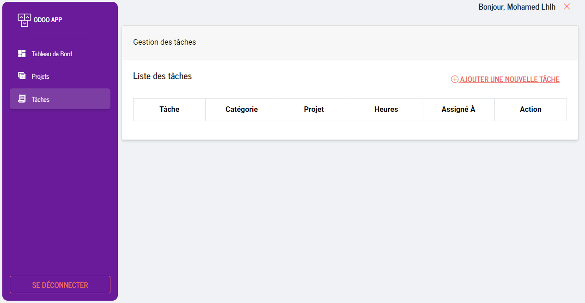

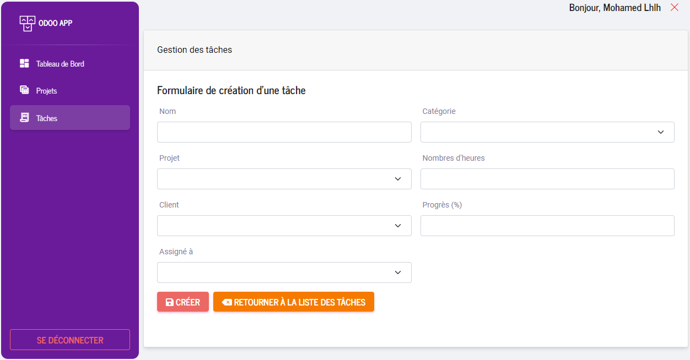

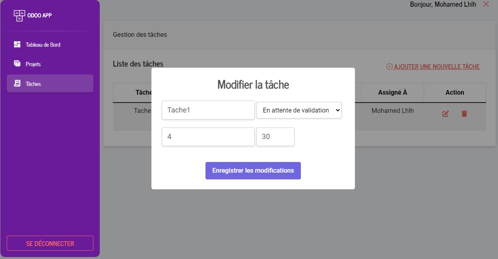

### Project management

The project list summarizes the number of tasks, total hours, and creation date. The project detail view groups tasks by workflow status.

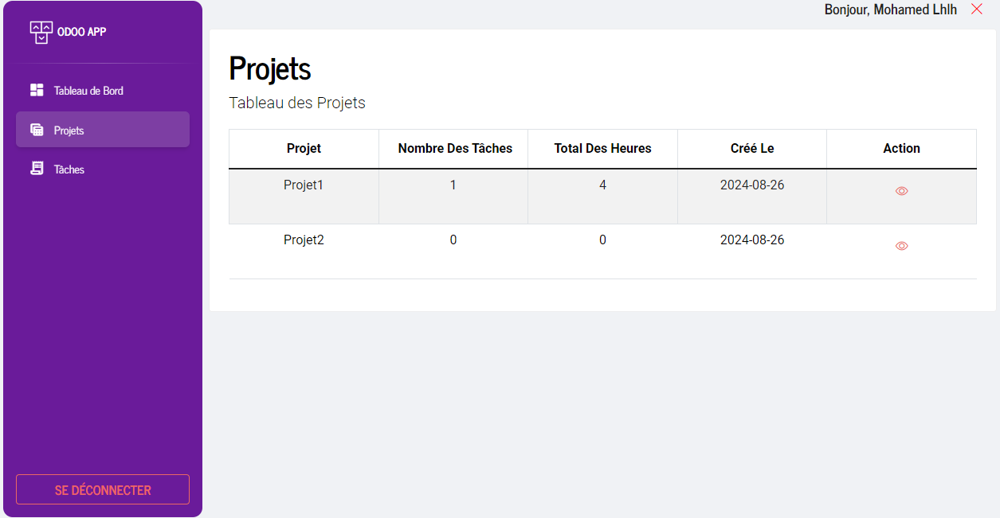

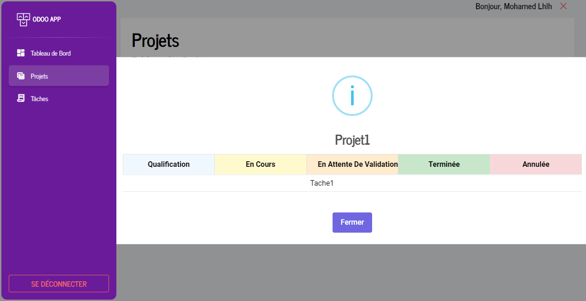

### Dashboard

The dashboard view shows navigation and summary cards for projects, users, and clients, along with chart areas for visits and completed tasks.

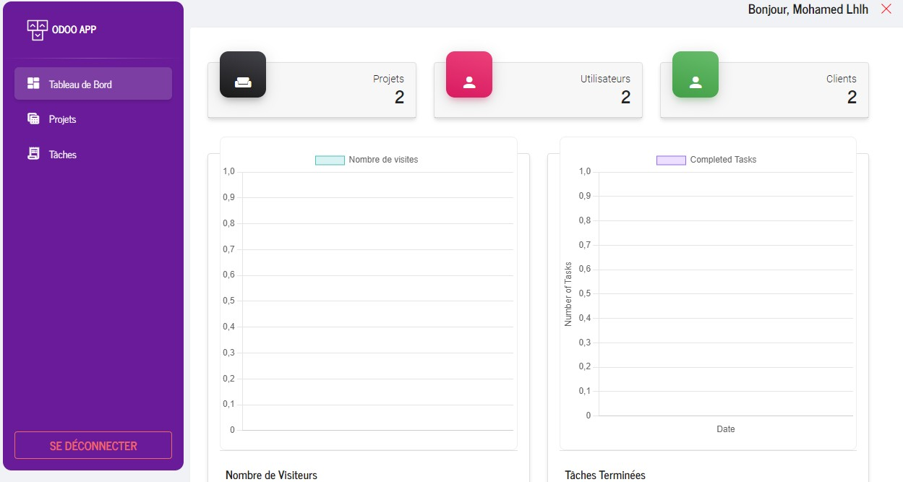

## Design mock-ups

The report appendix includes early page-structure and interface mock-ups alongside the application screenshots. These show the planned navigation, project view, task form, and task list.

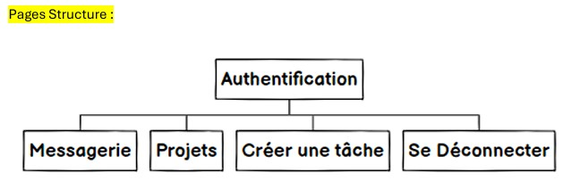

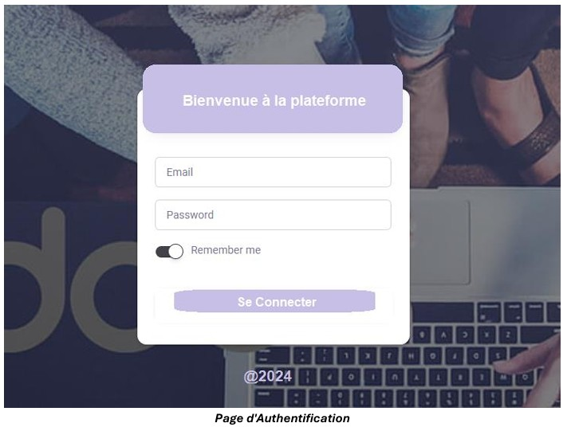

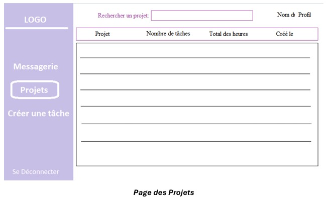

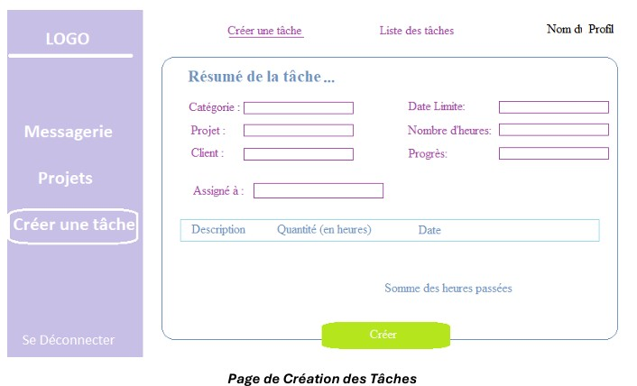

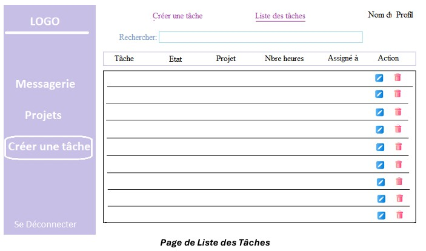

## Report-documented API routes

The report's technical appendix lists these Flask routes. This table reflects the report and is not a source-code verification; the application source is not included in this repository.

| Method | Route | Purpose described in the report |
|---|---|---|
| `GET`, `POST` | `/` | Display the login page, validate credentials, and establish a session. |
| `GET` | `/api/authentications` | Return authentication-event counts per day. |
| `GET`, `POST` | `/index` | Display application data and accept task creation. |
| `GET` | `/api/project/<project_name>` | Retrieve a project's details and associated tasks. |
| `PUT` | `/api/taskupdate/<int:task_id>` | Update a task and adjust related project aggregates when necessary. |
| `GET` | `/api/tasks/<int:task_id>` | Retrieve one task by ID. |
| `GET` | `/api/tasks` | Retrieve all tasks as JSON. |
| `GET` | `/api/projects` | Retrieve all projects as JSON. |
| `GET` | `/api/completed-tasks` | Return completed-task counts per day. |
| `DELETE` | `/api/taskdelete/<int:task_id>` | Delete a task and update its project's task count and total hours. |

The appendix also shows the Flask development server running locally:

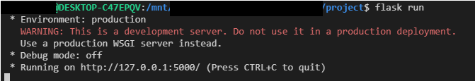

## Data model

The report describes the following TinyDB tables and fields:

| Table | Fields listed in the report | Purpose |
|---|---|---|
| `users` | `first_name`, `last_name`, `email`, `password` | User records used for authentication. |
| `projects` | `name`, `nombre_de_taches`, `total_heures`, `date_creation` | Project details and task/hour aggregates. |
| `tasks` | `id`, `name`, `category`, `project`, `hours`, `client`, `progress`, `assignee`, `status`, `date` | Task details and workflow state. |
| `clients` | `name`, `email`, `function` | Client records associated with tasks and projects. |
| `categories` | `name` | Task categories. |
| `auth_events` | `user_email`, `timestamp` | Login-event records used for daily counts. |

## Challenges, outcomes, and future improvements

The report identifies several implementation challenges and the approaches used:

- **Authentication and sessions:** use a login page and Flask session state to restrict access.
- **Data consistency:** update project totals and task counts when tasks are created, edited, or deleted.
- **User experience:** refine task and project forms, lists, and navigation iteratively.
- **Testing and debugging:** test core flows and fix data-update and interface issues.

The report's evaluation says task creation, updates, and deletion were working, project summaries reflected task changes, and feedback highlighted the usability of task and project management. It also records future ideas: role-based permissions, richer filtering and reporting, calendar/notification integrations, and mobile optimization.

### Prototype and security note

This repository documents an internship project; it is not a production-readiness statement. The report's appendix lists a literal `key` as the Flask session secret and describes exception handling as basic. Before deploying an implementation, replace development secrets, review password storage and session configuration, and add broader validation and error handling.

## Repository scope

The application source code, dependency manifest, and setup instructions are not present here, so this repository is currently a **report and documentation archive**, not a runnable application.

